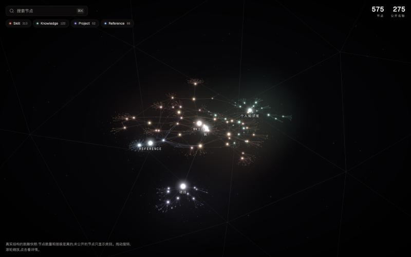
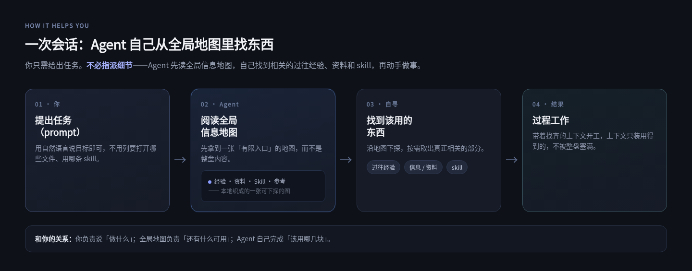
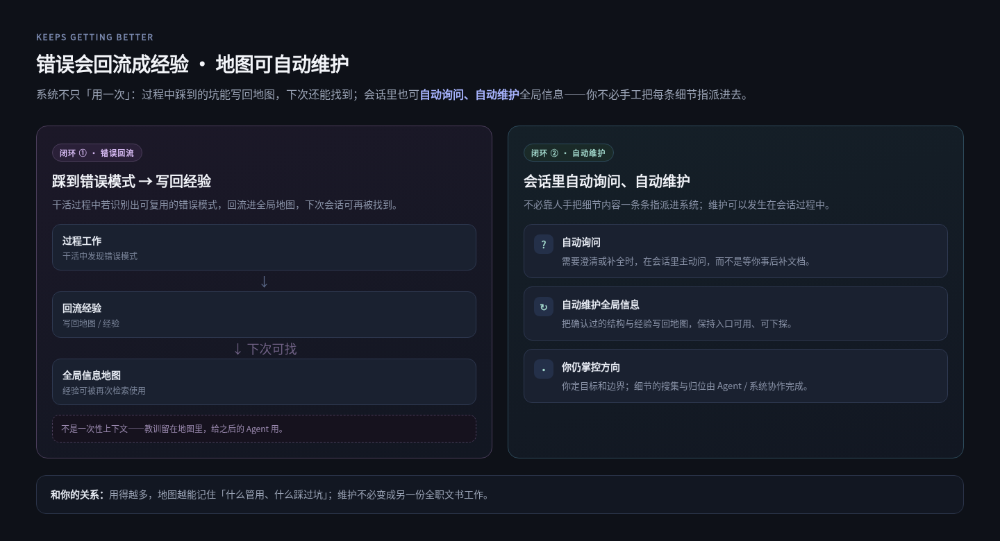
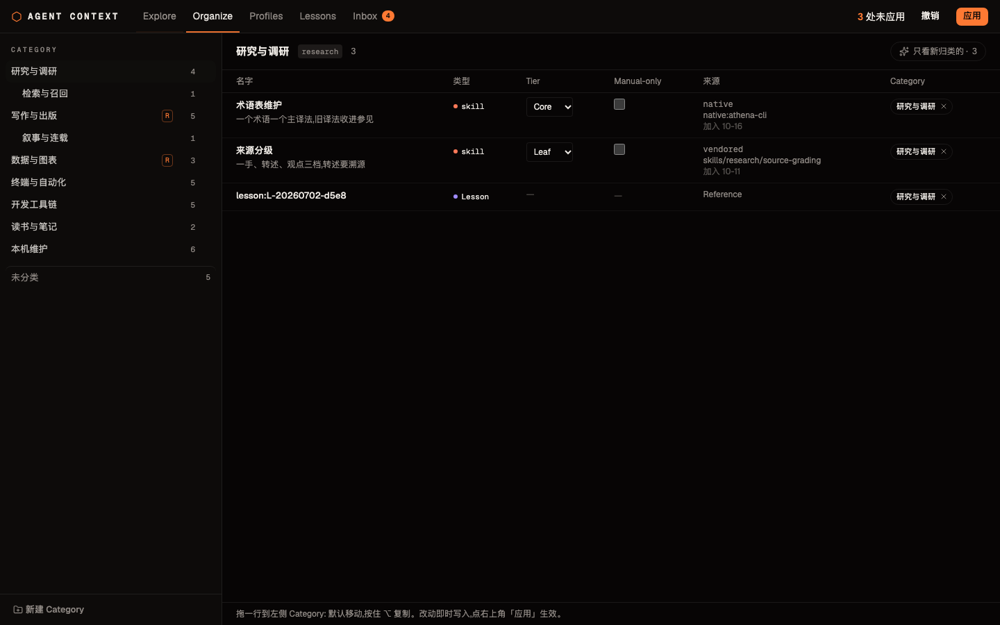

<div align="center">

# Agent Context System

**给本地 Agent 的全局信息入口：把知识库、项目与 Skill 织成一张有向图，Agent 先拿有限入口，再按需向下探索。**

SQLite 索引 + CLI，全部本地运行。




*Node index：本机知识库、项目与 Skill 织成的有向图；Agent 从顶层入口按需下探。*

</div>

## 和你有什么关系

你给 Agent 一个任务时，卡住的往往不是「不会做」，而是**不知道本机还有哪些经验、资料和 skill 可用**。

Agent Context System 在本地维护一张**全局信息地图**（节点索引）：Agent 先拿到有限入口，再按需向下探索——不必把整盘塞进上下文，也不必你每次手把手指路。



*一次会话：Agent 先读全局信息地图，再自己找经验、资料与 skill，不必你指派细节。*



*过程遇错可回流经验；会话会自动询问、自动维护全局信息，你仍定方向。*

**四件事（按优先级）：**

1. **全局节点索引** — Knowledge / Project / Skill / Reference 组成有向图，存在本机 SQLite；原文仍在磁盘。
2. **干活 Agent 接口** — 顶层小树注入 + `search` / `children` / `ancestors` / `get`，按需下探。
3. **Build & Activate** — 把 Index 树和 Router skill 写入各 AI Client 的规则与 skill 目录。
4. **星图控制台** — 给人看图、归类、审待确认节点；**是维护面，不是唯一价值**。

## Why

AI agent 在个人电脑上干活，卡住的第一件事往往不是不会做，而是**不知道东西在哪**：笔记散在知识库的几百个目录里，项目分布在各处，Skill 装了一层又一层。把整块磁盘塞进上下文不现实；让 agent 每次自己全盘搜索，又慢、结果又不稳定。

Agent Context System 维护一个**全局节点索引**：每个节点是信息层级中的一层，也可以挂载磁盘上的一个文件或文件夹，全部存进一个 SQLite 库。注入给 agent 的只有顶层的一棵小树和四条命令，要看细节时再沿节点向下读。

## Features

- **全局节点索引**：SQLite + FTS5 trigram；Reference / Knowledge / Project / Skill 四层组成有向无环图；挂载路径仍指向磁盘原文

- **干活 Agent 接口**：注入顶层 Index 树；`search`（关键词搜节点）、`children`（展开一层）、`ancestors`（回溯到根的完整路径）、`get`（读节点与挂载物路径）；均支持 `--json`

- **Build & Activate**：把 Index 树与 Router skill 生成并安装进各 AI Client 的规则文件与 skill 目录（Claude Code、Codex、Gemini CLI、Cursor 等）

- **维护控制台（星图 + Organize …）**：`ui/console/` 供人看图、归类、审 Inbox；Explore 星图与 Organize / Profiles / Lessons 等页是**维护面**，不是产品的唯一价值

  

- **全部本地**：数据在 `~/.local/share/node-index/index.db`，摘要接口自己配，不依赖任何云服务

## Getting started

需要 Python 3.11+（依赖只有 PyYAML；SQLite 需带 FTS5 trigram 扩展）。

```bash
git clone https://github.com/asd316/agent-context-system.git
cd agent-context-system
python3 -m pip install pyyaml
```

**1. 配置收录范围。** 编辑 `config/scope.yml`，把 `roots` 换成你自己的目录：

```yaml
host_roots: false
global_exclude:
  - .git
  - node_modules
  - .DS_Store
roots:
- path: ~/Documents/notes    # 换成你的笔记目录
  category: Knowledge        # Reference | Knowledge | Project | Skill
  depth: 1
- path: ~/code               # 换成你的项目目录
  category: Project
  depth: 1
```

字段含义见 [config/scope.example.yml](config/scope.example.yml)。要在多台机器共享根、或用 Build & Activate 把索引装进各 AI Client 时，再配置 `host/host.yml`（本机扫描根与 Client 清单）。

**2. 扫描建索引。**

```bash
bin/node-index scan
```

**3.（可选）生成 LLM 摘要。** `cp .env.example .env`，填入 OpenAI 兼容接口的地址、密钥与模型名，然后：

```bash
bin/node-index summarize --dry-run   # 先看会处理多少节点
bin/node-index summarize
```

**4. 查询。**

```bash
bin/node-index search 方法论
bin/node-index children n1
bin/node-index get n1 --json
```

扫描出来的节点先是「待确认」状态，用 `bin/node-index confirm <id>` 确认后即为正式节点。

**5. 星图控制台**（需要 Node.js 构建一次前端）：

```bash
cd ui/console/web && npm install && npm run build && cd ../..
python3 ui/console/server.py          # http://127.0.0.1:5180
```

**跑测试：**

```bash
python3 -m unittest discover -s tests
```

命令的完整契约（参数、输出、退出码）见 [docs/openapi.yaml](docs/openapi.yaml)；术语见 [GLOSSARY.md](GLOSSARY.md)；控制台细节见 [ui/console/README.md](ui/console/README.md)。

## License

[MIT](LICENSE)
